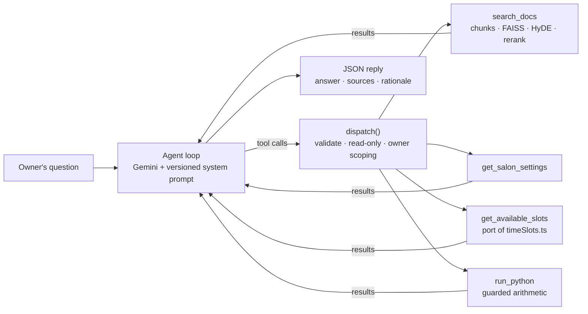

# Week 8 — Capstone: NailSalonApp Owner Assistant

A support assistant for the owner of a nail salon that uses my booking app, [NailSalonApp](https://github.com/BenMillerDev/NailSalonApp). It answers three kinds of questions:
- **How the app works:** retrieval over the app's documentation.
- **The owner's own settings:** a lookup of their hours, buffer time and blocked dates.
- **When they're open:** a tool that runs the app's real time-slot algorithm.

It's built almost entirely from components I made in Weeks 3–6. It's evaluated on 18 held-out questions with model-free metrics and an LLM judge, and one retrieval failure is traced to its root cause and fixed.

**In 60 seconds**
- **Four techniques in one tool-calling agent:** a versioned prompt (Week 3), function calling (Week 4), RAG (Week 5), and HyDE plus reranking (Week 6).
- **Answers come from tools, never the model's memory.** Open slots come from a Python port of the app's `timeSlots.ts`, so the assistant gives the same times the booking site would.
- **Safe by design:** every tool is read-only and scoped to the signed-in salon. The model can't choose whose data it reads.
- **18 held-out questions:** every model-free check scored 1.00, and the judge averaged **4.67 / 5.00 / 5.00** for correctness, groundedness and appropriate abstention.
- **One failure traced and fixed:** a roadmap answer buried in a seven-item paragraph. Splitting list paragraphs into one chunk per item moved it from **7th to 1st** and raised found@3 from **0.95 to 1.00**, and no other question changed.

## Architecture

Gemini (`gemini-3.5-flash-lite`) decides which tools to call and with what arguments. `dispatch()` checks every call before it runs, and the results go back to the model until it writes its final answer. The answer has to come only from tool results, in a JSON object that names its sources and the reasoning behind it.

Owner data (hours, bookings, the service menu) is mocked in the same shapes as the app's Firestore documents. There are two salons, so the owner scoping can be tested.

## Techniques, where they came from, and why

| Technique | Reused from | What it does here | Why |
|---|---|---|---|
| Versioned prompt with JSON output and a rationale | [Week 3](../week-3) ([#7](https://github.com/BenMillerDev/Applied-LLM-Systems/pull/7)) | `prompts/assistant_v1.md` sets which tool answers which kind of question and the rules for roadmap features and refusals. It requires `answer`, `sources` and `rationale`. | A prompt change becomes a reviewable diff. The `sources` and `rationale` fields give the metrics and the judge something concrete to check. |
| Function calling with validated dispatch | [Week 4](../week-4) ([#10](https://github.com/BenMillerDev/Applied-LLM-Systems/pull/10)) | Week 4's `run_agent`, `validate()`, `dispatch()` and guarded `run_python`, with list arguments, read-only enforcement and owner scoping added | Open appointment times can't be retrieved or reasoned out reliably; they have to be computed with the app's own rules. |
| RAG with paragraph chunking | [Week 5](../week-5) ([#12](https://github.com/BenMillerDev/Applied-LLM-Systems/pull/12)) | The same 11-doc corpus, MiniLM embeddings and FAISS index, wrapped as the `search_docs` tool, which returns each passage with its source doc | Paragraph chunking was Week 5's best configuration (recall@3 of 1.00), and the docs are the only source for how the app works. |
| HyDE and cross-encoder reranking | [Week 6](../week-6) ([#14](https://github.com/BenMillerDev/Applied-LLM-Systems/pull/14)) | Each can be switched on or off by itself, so Part 3 could test them separately | Week 6 showed they help short chunks. Here they're measured rather than assumed, and on paragraph chunks neither changed recall. |

Two pieces are new this week:
- **`get_available_slots`,** a Python port of `getAvailableSlots` from the app's [`timeSlots.ts`](https://github.com/BenMillerDev/NailSalonApp/blob/4df756e2504da6ad1782388ca573c330d029238b/src/utils/timeSlots.ts) and `getBookingsForDate` from its booking service.
- **An LLM-as-judge** with its own versioned prompt.

### Safety design
- **Read-only:** each tool is marked `access: 'read'`. `dispatch()` refuses anything else, so a future tool that books or cancels is blocked until it's deliberately allowed.
- **Owner-scoped:** no tool takes an owner id from the model. `dispatch()` adds the signed-in owner's id itself, and `validate()` rejects an `owner_id` argument, so a prompt can't point a tool at another salon's data.
- **Constrained arguments:** service ids are listed in the tool schema as the only allowed values, so the model can't invent one. That's the Week 4 lesson applied up front.
- **Minimal data:** like the app's own query, the booking lookup returns only appointment times, never client names or phone numbers.

## Evaluation (Part 2)

The 18 held-out questions were written after the system was built and kept separate from everything used to tune it. They cover:
- 6 questions about how the app works;
- 5 slot questions (one asked as the second salon);
- 2 questions about the owner's settings;
- 2 roadmap features that should get "not yet";
- 2 questions the docs don't cover;
- 1 request to make a change, which should be refused.

Every reference answer was worked out by hand, including the slot times, so the evaluation doesn't just check the tool against itself.

| Metric | Result |
|---|---|
| Right tools called | 1.00 |
| Slot lookup used the right date and services | 1.00 |
| Search returned the passage with the answer | 1.00 |
| Key facts in the answer | 1.00 |
| Right doc cited | 1.00 |
| Valid JSON reply | 1.00 |
| Similarity to the reference (Week 3's `semantic_sim`) | 0.80 |
| **Judge: correctness / groundedness / abstention (1–5)** | **4.67 / 5.00 / 5.00** |
| Retrieval recall@3 on the held-out questions: paragraph / + rerank / + HyDE + rerank | 0.88 / 0.88 / 0.88 |

The judge (`gemini-3.5-flash`, a larger model than the assistant) writes a reason before each score.
- **Correctness:** reviewing every reason, all six 4s were for details my reference answers added, never for a wrong fact.
- **Groundedness:** it never dropped below 5. The one case I'd score lower is the refusal, which tells the owner to "make that change in the app" without any tool result backing it.

## Failure traced and fixed (Part 3)

**Case 14,** "Can I add a second nail tech to my salon account?", never found its answer when searching with the owner's words. The assistant only got it right by searching a second time with different keywords.

**The cause:** the answer is one item in a seven-feature roadmap paragraph. Two tests separated the possible causes:
- Rewording the question in the doc's own vocabulary barely helped (7th → 6th).
- The question was nearly twice as similar to that one item on its own (0.499) as to the whole paragraph (0.269).

So the cause was dilution in Week 5's paragraph chunking, not vocabulary. HyDE didn't help: its passage invented a "Staff Management" settings screen.

**The fix:** split list paragraphs into one chunk per item, each keeping its lead-in ("Planned but not yet built: …"):
- The answer moved from 7th to 1st.
- Found@3 across 19 questions went from 0.95 to 1.00. Only case 14 changed.
- In the full 18-case rerun, no judge score went down.
- Case 14 now finds its answer on the first search.

The notebook's write-up covers what's left: the model's search wording varies between runs, and it still rewrites questions into keywords before searching.

## Results page

The [results page](https://benmillerdev.github.io/Applied-LLM-Systems/week-8/results/) shows every saved run from the notebook:
- all 18 held-out cases and the 4 demo questions, filterable by category;
- for each one, every tool call with its arguments and result, the HyDE passage, the answer and its sources, the model-free checks and the judge's reasons;
- a switch between the Part 2 runs and the reruns with the Part 3 fix, plus the [second-nail-tech question](https://benmillerdev.github.io/Applied-LLM-Systems/week-8/results/#case-14) before and after.

It's generated from `cache/` and the notebook, so it shows exactly the runs the notebook reports.

## Contents
- `week8_capstone.ipynb` — the full notebook, run top to bottom: Part 1 builds the system, Part 2 evaluates it, Part 3 traces the failure. It clones this repo's docs and prompts automatically if they aren't already present.
- `prompts/` — `assistant_v1.md` (the assistant's system prompt) and `judge_v1.md` (the judge's rubric)
- `cache/` — every model response from my run, so the notebook reproduces these results without an API key (see `cache/README.md`)
- `results/` — the results page: `index.html` (the page), `results_template.html` (its layout) and `build_results_page.py`, which rebuilds the page from `cache/` and the notebook with `python week-8/results/build_results_page.py`

## Running it
Open the notebook in Colab and run all cells. With a `GEMINI_API_KEY` Colab secret, any missing responses are generated and saved to Drive. Without one, every result loads from `cache/`.

## Next steps
- **Turn HyDE off.** It added a model call per search with no measured gain, and it invents details.
- **Add a v2 prompt** that tells the assistant to search with the owner's own wording before rewriting it.
- **Run it on the real app.** The assistant would go in a Firebase Cloud Function and import the real `timeSlots.ts` instead of a port. The owner id would come from the verified Firebase Auth token, and the tools would read Firestore directly.

## Research log
Findings and methodology notes: #17

